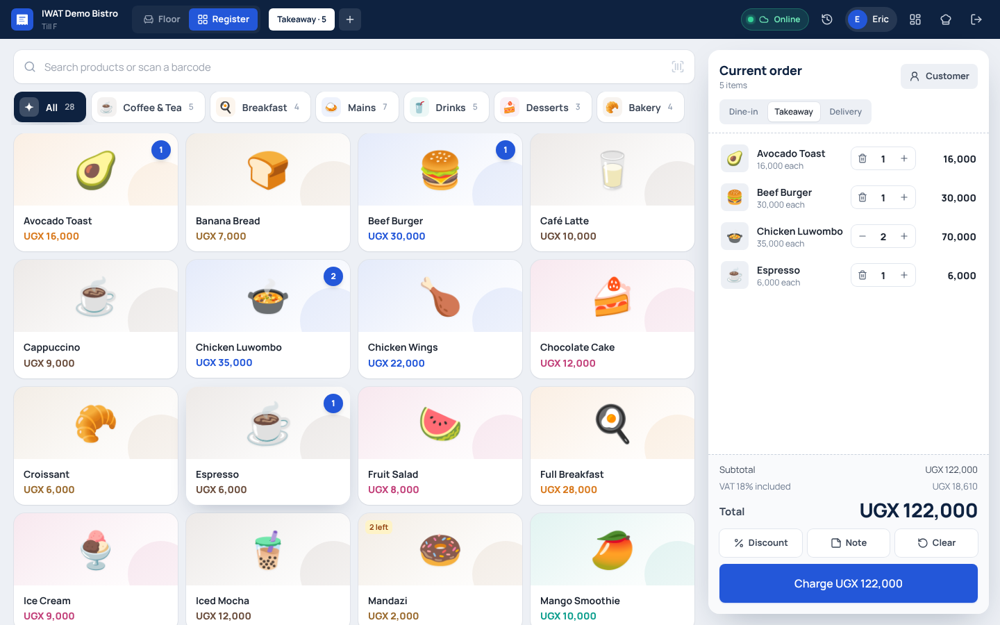

# IWAT POS

Point of sale for restaurants, cafés, bars and shops that keeps selling when the internet doesn't.
One codebase runs as a website and as an installable app on Android, iPhone, iPad, Windows and Mac.



## What’s inside

| Area | For | Highlights |
|---|---|---|
| Register `/pos` | Cashiers | Product grid, barcode search, several open orders, dine-in / takeaway / delivery, customers & loyalty, discounts, notes, split payments (cash, MTN MoMo, Airtel Money, card), printable receipts, PIN staff switch |
| Floor plan | Waiters | Live table status: free, order in progress, cooking, food ready |
| Kitchen display `/kitchen` | Kitchen | New → Cooking → Ready columns, new-ticket chime, late-order warnings |
| Business dashboard `/admin` | Owners, managers | Revenue, profit, busiest hours heatmap, payment mix, best sellers, low stock, team performance, portal launcher |
| Sales portal | Owners, managers | Sales report by product, category, cashier, hour, payment method and order type; margins; orders & refunds; customers & loyalty; CSV export |
| Inventory portal | Owners, managers | Stock value at cost and retail, reorder suggestions that turn into purchase orders, full stock-movement ledger, guided stock count |
| Purchases portal | Owners, managers | Suppliers with balances owed, purchase orders (draft → ordered → received), receiving updates stock with weighted-average cost, supplier payments |
| Accounting portal | Owners, managers | Profit & loss, VAT payable (output less input), cash in/out by method, six-month trend, expenses, double-entry journal and trial balance, CSV exports |
| Admin portal | Owners | Team & PINs, QR menu, activity log, business settings, floor-plan editor, devices, plan |
| QR menu `/m/<business>` | Guests | Scan the table code to see the live menu on any phone: categories, search, popular items, sold-out labels, a “my choices” list to show the waiter |
| Platform console `/super` | IWAT staff | Recurring revenue, sales across all businesses, create / suspend / re-plan businesses, logged support sign-in, audit log |

### How offline works

1. The first visit stores the whole app on the device (service worker). After that it opens with no connection.
2. The menu, tables and customers are kept in the browser's database (IndexedDB).
3. Every sale is written to the device first, then uploaded. If the line is down, sales wait in a queue and upload automatically when the server is reachable again.
4. Each sale carries a unique ID, so a retried upload never creates a duplicate.
5. The status pill in the top bar shows **Online**, **Offline**, or how many sales are waiting.

Sign-in, adding new customers and staff PIN switching need a connection; selling does not.

### QR table menus

In **Admin → QR menu**, print one card per table (or download each code as an image). Each code opens `/m/<business>?table=<id>`, so guests see their table number. Prices and sold-out items come straight from your products; hide anything you don't want guests to see. The menu can be switched off at any time.

## Demo accounts

The database fills itself with a demo the first time it starts (7 businesses, ~5,700 orders over 75 days).

| Role | Email | Password | Till PIN |
|---|---|---|---|
| Business owner | owner@demo.com | Owner@123 | 1111 |
| Manager | manager@demo.com | Manager@123 | 2222 |
| Cashier | cashier@demo.com | Cashier@123 | 1234 |
| Kitchen | kitchen@demo.com | Kitchen@123 | 5555 |
| Platform admin | super@iwatpos.com | Super@123 | – |

**Before real use:** change these passwords, or start fresh with `SEED_DEMO=false` on an empty database.

## Deploy on Railway

1. Push this folder to `github.com/mubazieric/POS`.
2. In Railway: **New project → Deploy from GitHub repo** → pick `POS`. Railway reads `railway.json` and builds the `Dockerfile`.
3. In the same project: **New → Database → PostgreSQL**.
4. Open the app service → **Variables** and add:
   - `DATABASE_URL` = `${{Postgres.DATABASE_URL}}`
   - `JWT_SECRET` = a long random string (`openssl rand -hex 32`)
   - `APP_TZ` = `Africa/Kampala`
5. **Settings → Networking → Generate domain.** Open it; the first boot creates the tables and the demo (about a minute).

To wipe and reload the demo later, run `npm run reset-demo` from a Railway shell.

## Run locally

With Docker: `docker compose up --build` then open http://localhost:3000.

Without Docker (needs Node 20.19+ or 22.12+ and PostgreSQL):

```bash
cp .env.example .env          # edit DATABASE_URL
npm install
npm --prefix client install
npm run dev:server            # API on :3000
npm run dev:client            # app on :5173, proxies /api to :3000
```

## Project layout

```
server/            Express API
  schema.sql       tables (created automatically on boot)
  seed.js          demo data
  routes/          auth, pos (register/kitchen/sync), admin (business), super (platform)
client/            React + Vite + Tailwind web app
  public/sw.js     offline service worker
  src/lib/offline.js   IndexedDB catalog + sales queue + sync
  src/pages/pos/   register, floor plan, payment, receipt
  src/pages/admin/ business dashboard pages
  src/pages/super/ platform console pages
Dockerfile, railway.json, docker-compose.yml
```

## Roadmap ideas

- Native store apps by wrapping the web app with Capacitor (same code).
- Live MTN MoMo / Airtel Money collection APIs and card terminal integration.
- Receipt printers over Bluetooth/USB (ESC/POS), cash drawer kick.
- Multi-branch stock transfers, purchase orders, EFRIS e-invoicing for URA.
